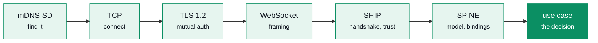

+++
title = "eebus"
template = "index.html"
[extra]
landing = true
lede = "Connect appliances and energy managers with the SHIP transport, SPINE device model and 28 energy use cases."
status = "Rust 1.88+ · MIT or Apache-2.0"

hero_code = """
```rust
// Cap a 10 kW inverter at 40% of rated output.
let mut guard = EnergyGuardActor::new(lpp::DIRECTION, client, diagnosis, now);
guard.require(&inverter, Some(LimitWrite::active(4_000.0)), now)?;

// Once commissioned, the guard writes −4,000 W over SPINE.
if let Some(GuardEvent::LimitAccepted { limit, request, .. }) =
    guard.handle_event(&mut engine, &event, now)
{
    println!("Write {} accepted: {} W", request.get(), limit.watts());
}
```
"""

[[extra.stats]]
value = "830"
label = "SPINE types, generated"
[[extra.stats]]
value = "28"
label = "use cases, both actors"
[[extra.stats]]
value = "no_std"
label = "below the runtime"
[[extra.stats]]
value = "TLS 1.2"
label = "mutual auth, SKI-pinned"

[[extra.features]]
title = "Embedded or networked"
body = "Drive SHIP and SPINE with your own clock and transport, or use the Tokio runtime for TLS, WebSocket and mDNS."

[[extra.features]]
title = "Application-controlled limits"
body = "The Energy Guard commissions a writable limit. The appliance applies its local policy and acknowledges the result."

[[extra.features]]
title = "Measured conformance"
body = "Library tests exercise 189 of 203 abstract test cases for the grid use cases. A device harness covers procedures such as power cycling and factory reset."

+++

## The exchange, end to end

A control box discovers a heat pump, establishes trust and writes a power limit.
The appliance acknowledges the write over the same connection.



## Who it is for

| You are building | You need | Start at |
|---|---|---|
| A heat pump, wallbox, battery or inverter that must accept a §14a limit | the Controllable System actors, the tester hooks, `no_std` | [Getting started](@/docs/getting-started.md), then [LPC and LPP](@/docs/limitation.md) |
| An energy manager or grid control box that issues limits | the Energy Guard and Monitoring Appliance actors, `Hub` with its listener, browse and pairing | [On a network](@/docs/networking.md) |
| A gateway, simulator or test harness | the sans-IO core, without sockets | [Architecture](@/docs/architecture.md) |
