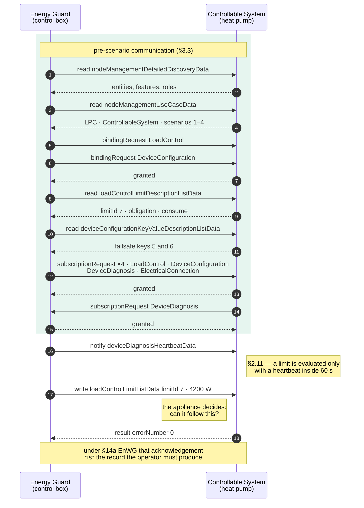
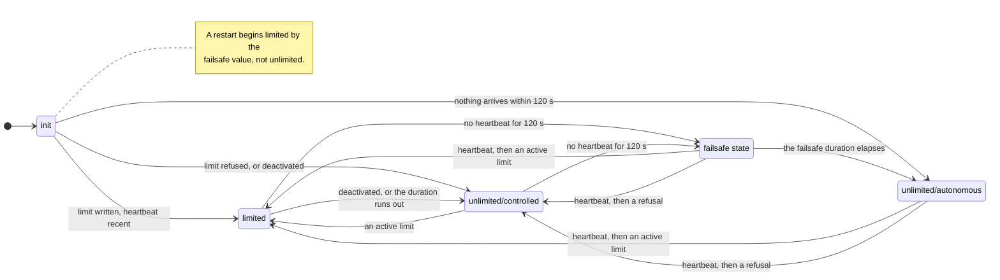

+++
title = "LPC and LPP"
description = "Limitation of Power Consumption and Production: the §14a EnWG use case, its four scenarios, the failsafe state machine, and both actors including the Energy Guard's write rules."
weight = 80
[extra]
group = "Use cases"
+++

In **Limitation of Power Consumption** an Energy Guard tells a Controllable System how much
power it may draw, and the system honours it. **Limitation of Power Production** is
the same thing for feed-in. Together they are the technical basis for §14a EnWG and §9 EEG.

## The exchange, end to end

From a fresh connection to an acknowledged limit. The binding grants the right to write,
the subscription makes the heartbeat arrive, and §2.11 evaluates a limit only with a recent
heartbeat behind it — from the Energy Guard entity that holds both bindings (the feature
the Controllable System subscribed to under §3.8), not from any other peer.



## The four scenarios

1. **Control the active power limit** — the limit itself, with an optional duration,
   acknowledged or refused.
2. **Failsafe values** — what applies when the Energy Guard falls silent, and for how long
   at minimum.
3. **Heartbeat** — a message every sixty seconds in each direction; its absence is what
   triggers the failsafe.
4. **Constraints** — the nominal maxima, so the Energy Guard knows what it is limiting.

## The state machine

A Controllable System is always in one of these states:



**`unlimited/controlled`** means an Energy Guard is present and asking for nothing; a
refusal also leads here, because it proves a controller is there.
**`unlimited/autonomous`** means nobody is in control and the device runs its own logic,
which it may do only once the failsafe duration has elapsed.

The failsafe is mandatory. §14a fixes 4.2 kW as the floor an installation must keep
available, and the failsafe duration has a minimum.

```rust
use core::time::Duration;
use eebus::usecases::limitation::{ControllableSystem, CsConfig};

// A heat pump that falls back to the 4.2 kW §14a leaves it, for at least two hours.
let system = ControllableSystem::new(
    CsConfig::new(4_200.0, Duration::from_secs(2 * 3_600)).with_nominal_max(11_000.0),
    Duration::ZERO,
);
```

## The application decides

A limit write is answered by the application, not by a generic setter: under §14a the
acknowledgement is the record that the limit was applied, so it reports what the appliance
actually did.

```rust
match engine.poll_event() {
    Some(SpineEvent::WriteRequested(w)) => {
        let write = limitation::read_limit_write(&w.resolved)?;   // merged, not the fragment
        match system.on_limit_write(&write, decide(&write), now) {
            WriteOutcome::Accepted => engine.accept_write(w.token, now),           // ACK
            outcome => engine.reject_write(w.token, outcome.error_number(), now),  // NACK
        }
    }
    _ => {}
}
```

## The other half: the Energy Guard

The controlling side's rules live behind one call:

```rust
guard.require(&device, Some(LimitWrite::active(4_200.0)), now);
```

The guard takes up a peer that announces the Controllable System by itself, and a limit
required before the peer is reachable is held, not discarded.

Behind that line:

* the peer's own identifiers, read before anything is written. `limitId` is `<l1#(1..1)>`
  in Table 22 and the two failsafe `keyId`s are `<k1#(1..1)>` and `<k2#(1..1)>` in Table 24;
  the numbers belong to the device, and the specification fixes only the limit's type,
  category, direction and scope, and the keys' names. Nothing is written until the
  descriptions come back (`is_ready`; `peer_ids` reports them);
* a heartbeat immediately before the write, and only once the peer has subscribed to it
  (§2.11), since a notification reaches only subscribers;
* an opening write on the limit as soon as the bindings settle, whether or not the grid is
  asking for anything, because until it lands the Controllable System is not controllable
  (§2.11);
* never a deactivation as the first limit after a reconnection (§2.13);
* never a zero duration on an activated limit (§2.2);
* a refusal retried a minute later, and a minute later again, with the device kept (§2.5);
* and no more than one write every five minutes otherwise (§2.10), the opening write
  excepted.

### The duration is a relative time, and an unreadable one is refused

§3.1.8.2: "Durations used within this Use Case SHALL be presented as relative times. The
same holds for the `endTime` Element used for the duration of validity ([LPC-004])." The
schema allows more: `timePeriod.endTime` is the `AbsoluteOrRelativeTimeType` union, so
`2026-09-05T10:00:00Z` is schema-valid and use-case-invalid.

`read_limit_write` refuses an `endTime` it cannot read as a relative duration, and the
refusal reaches the guard as a NACK; reading it as absent would mean no expiry. The same
rule covers a `scaledNumber` whose scale overflows, and
[COB](https://docs.rs/eebus/latest/eebus/usecases/cob/index.html) applies it to its own
setpoint duration, whose §3.1.8.2 says the same thing. See
[Where a use case is narrower than the schema](@/docs/wire-format.md#where-a-use-case-is-narrower-than-the-schema-the-use-case-wins).

A peer whose `LoadControl` feature describes no limit for this guard's direction reports
`GuardEvent::NoLimitPublished` and is then left alone — usually a device that implements
the other direction, or an actor that was never installed. Because the read succeeds, this
event is the only sign of it.

## Scenario 4: what the Energy Guard is limiting

Scenario 4 publishes what the Controllable System is, as one of two mutually exclusive
values:

* **Power Consumption Nominal Max** ([LPC-041]) — the nameplate, what the appliance can
  physically draw. UC TS §2.6.4.1: for a device, and *not* for an energy manager.
* **Contractual Consumption Nominal Max** ([LPC-042]) — what the customer's contract
  allows. For an energy manager, and not for a device.

Which one is published follows from the configuration:

```rust
let device = ControllableSystem::new(
    CsConfig::new(4_200.0, failsafe_duration).with_nominal_max(11_000.0),
    now,
);
let manager = ControllableSystem::new(
    CsConfig::new(4_200.0, failsafe_duration).with_contractual_max(30_000.0).on_cem(),
    now,
);
```

An Energy Guard reads it in the pre-scenario exchange and hears about it as
`GuardEvent::ConstraintsLearned`. LPP names the same two values
`powerProductionNominalMax` and `contractualProductionNominalMax`.

## The §14a record

Every accepted or refused limit is recorded with its timestamp, value and outcome — the
evidence the regulation asks for.

```rust
guard.audit().records();   // what was asked, what was answered, when
```
