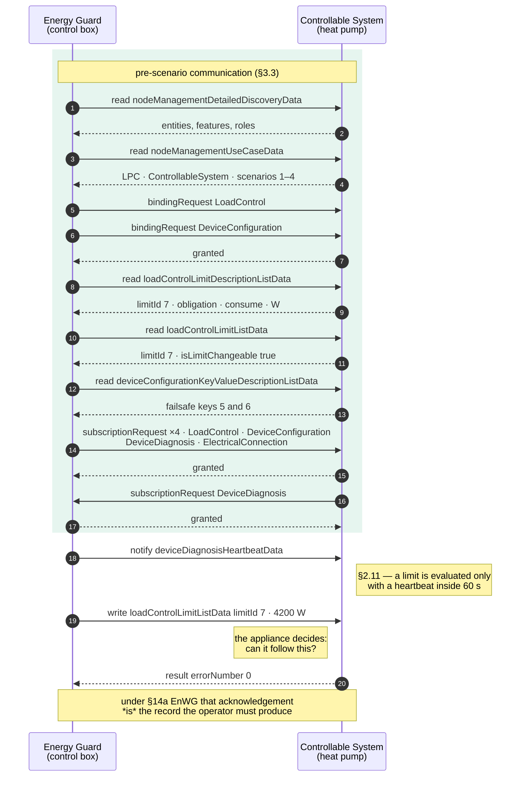
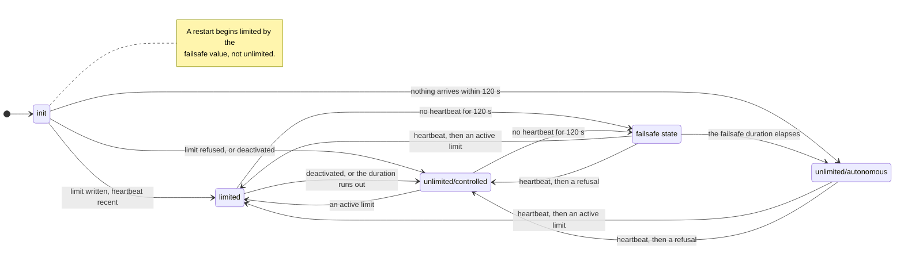

+++
title = "LPC and LPP"
description = "Limitation of Power Consumption and Production: the §14a EnWG use case, its four scenarios, the failsafe state machine, and both actors including the Energy Guard's write rules."
weight = 80
[extra]
group = "Use cases"
+++

In **Limitation of Power Consumption** an Energy Guard tells a Controllable System how much
power it may draw, and the system honours it. **Limitation of Power Production** is
the same thing for feed-in. Together they are the technical basis for §14a EnWG and §9 EEG.

## The exchange, end to end

From a fresh connection to an acknowledged limit. The binding grants the right to write,
the subscription makes the heartbeat arrive, and §2.11 evaluates a limit only with a recent
heartbeat behind it — from the Energy Guard entity that holds both bindings (the feature
the Controllable System subscribed to under §3.8), not from any other peer.



## The four scenarios

1. **Control the active power limit** — the limit itself, with an optional duration,
   acknowledged or refused.
2. **Failsafe values** — what applies when the Energy Guard falls silent, and for how long
   at minimum.
3. **Heartbeat** — a message every sixty seconds in each direction; its absence is what
   triggers the failsafe.
4. **Constraints** — the nominal maxima, so the Energy Guard knows what it is limiting.

## The state machine

A Controllable System is always in one of these states:



**`unlimited/controlled`** means an Energy Guard is present and asking for nothing; a
refusal also leads here, because it proves a controller is there.
**`unlimited/autonomous`** means nobody is in control and the device runs its own logic,
which it may do only once the failsafe duration has elapsed.

The failsafe is mandatory. §14a fixes 4.2 kW as the floor an installation must keep
available, and the failsafe duration has a minimum.

```rust
use core::time::Duration;
use eebus::usecases::limitation::{ControllableSystem, CsConfig};

// A heat pump that falls back to the 4.2 kW §14a leaves it, for at least two hours.
let system = ControllableSystem::new(
    CsConfig::new(4_200.0, Duration::from_secs(2 * 3_600)).with_nominal_max(11_000.0),
    Duration::ZERO,
);
```

## The application decides

Pass each event to the Controllable System actor. For a readable limit, the policy receives
the merged state of the addressed entry and decides whether the appliance can apply it.
The actor handles the result message and audit record.

```rust
if let Some(CsEvent::LimitDecided { write, outcome, .. }) =
    pump.handle_event_with(&mut engine, &event, now, decide)
{
    println!("{} W, active={}: {outcome:?}", write.watts(), write.is_active);
}
```

A policy for an inverter receives a positive magnitude for a nonzero production cap.
Use `write.is_active` to distinguish an active zero from a release. Applications that
always follow valid limits can use `handle_event`.

## Refusing a limit by policy

Only the peer holding the `LoadControl` binding can write a limit. Use
`handle_event_with` to apply device policy. LPC §2.2 permits an appliance to refuse
for self-protection, safety or a regulatory requirement. An energy manager may also
refuse if uncontrolled loads prevent it from meeting the limit.

The following example assumes a directly controlled heat pump with a configured
4,200 W minimum. Use the floor applicable to the installation.

```rust
use eebus::usecases::limitation::{LimitWrite, LocalDecision, RejectReason};

/// Configured minimum for this installation.
const FLOOR_WATTS: f64 = 4_200.0;

fn policy(write: &LimitWrite) -> LocalDecision {
    if write.is_active && write.watts() < FLOOR_WATTS {
        LocalDecision::Reject(RejectReason::Regulatory)
    } else {
        LocalDecision::Apply
    }
}

pump.handle_event_with(&mut engine, &event, now, policy);
```

The refusal goes to the guard as `errorNumber` 7 with no reason attached ([LPC-003]). It is
recorded in `pump.audit()` as `Rejected(CannotApply(Regulatory))`, with the device address
of the peer that sent it. The heartbeat gate is checked first: a write with no recent
heartbeat is `NoRecentHeartbeat` whatever the policy answers.

An energy manager can allocate its total limit among several appliances, including
a 0 W allocation. Apply a site-wide floor at the manager. A refusal keeps a
`limited` system limited. In `init` or `failsafe`, a policy refusal transitions
to `unlimited/controlled` (LPC-902, LPC-907, LPC-918).

Run the example policy with `cargo run --example heat_pump --features full -- --floor 4200`.

## Exact values

The local API accepts a nonnegative magnitude for both directions. A 10 kW inverter
limited to 40% of rated output receives a −4,000 W active production limit. Its local
policy sees 4,000 W and its SPINE readback reports −4,000 W.

| Grid request | Local `require` argument | LPC wire value | LPP wire value | `isLimitActive` |
|---|---|---:|---:|---|
| Limit to 4 kW | `Some(LimitWrite::active(4_000.0))` | +4,000 W | −4,000 W | `true` |
| Limit to zero | `Some(LimitWrite::active(0.0))` | 0 W | 0 W | `true` |
| Release the limit | `None` | 0 W | 0 W | `false` |

The sign applies specifically to the Active Power Production Limit. Failsafe Production
Active Power Limit, Power Production Nominal Max and Contractual Production Nominal Max
all use nonnegative wire values. The tester signal `lpp:limit` follows the active limit’s
wire sign. Application policies and audit records report the magnitude. When
`isLimitActive` is false the peer ignores the numeric limit. See §2.8.1 and Tables 22–23 of the [LPP technical specification](https://www.eebus.org/specifications/).

Use `ScaledNumber` to pass precise decimal magnitudes through the guard, the appliance's
policy and its audit log.

```rust
use eebus::model::ScaledNumber;

let config = CsConfig::new_scaled(ScaledNumber::new(42_005, -1), failsafe_duration);
guard.require(&device, Some(LimitWrite::active_scaled(ScaledNumber::whole(3_000))), now)?;
let applied = pump.system().effective_limit().scaled();   // Some(3000 W), exactly
```

From `f64`, a value keeps three decimals; a whole number of watts goes out at scale 0.

## The other half: the Energy Guard

The controlling side's rules live behind one call:

```rust
guard.require(&device, Some(LimitWrite::active(4_200.0)), now)?;
```

The guard holds a requirement made before the peer is reachable. A successful
`require` schedules the requirement. `GuardEvent::LimitAccepted` reports the
acknowledgment from the peer. An invalid magnitude returns `InvalidLimit` before
scheduling and preserves the existing requirement.

After commissioning, the guard sends a heartbeat before the opening write (§2.11).
On reconnect it reapplies the current requirement (§2.13). An active write carries
a positive duration or no expiry (§2.2). Ordinary writes are spaced five minutes
apart (§2.10). After a refusal the retry delay increases by one minute per refusal (§2.5).

### Commissioning a writable limit

When a request names a device, discovery must identify a single eligible Controllable
System for the selected direction. Its `LoadControl` feature must advertise write access
to `loadControlLimitListData`. The guard reads two lists on that feature.

1. **Descriptions.** Exactly one entry must specify `signDependentAbsValueLimit`,
   `obligation`, the requested direction and `activePowerLimit`. It must declare unit
   `W` and have a `limitId` used once in this feature's descriptions.
2. **Current limits.** Exactly one entry must carry that ID, with
   `isLimitChangeable = true`. A read-only entry, a missing flag or a duplicate leaves
   the target unavailable.

List order has no effect. Commissioning starts from a complete snapshot of each list.
Later partial updates are merged into those snapshots. If the engine has evicted a
snapshot, the guard reads the missing list again before accepting a partial update as
evidence of writability. The guard waits for both bindings
before the opening write. It learns the two failsafe key IDs separately from the peer's
`DeviceConfiguration` descriptions. `is_ready` reports readiness for the limit and
`peer_ids` exposes the discovered identifiers.

A controller that already has both resolved lists for one feature can call the resolver
directly.

```rust
use eebus::usecases::limitation::{Direction, resolve_writable_limit};

let id = resolve_writable_limit(&descriptions, &current, Direction::Production)?;
```

A failed lookup returns `LimitResolutionError`. The guard reports an unusable limit as
`GuardEvent::LimitUnavailable { device, reason }`. Surface the reason to the installer.
If refreshed lists invalidate a previously writable limit, the guard suspends limit writes
until it can resolve a writable target again.

When the engine removes a peer, forward `SpineEvent::PeerRemoved` to the guard with
`handle_event`. The guard retains the grid requirement and repeats commissioning on
reconnection. To stop controlling a peer and discard the requirement, call
`guard.detach(&mut engine, &device)`. To lift the limit on a connected appliance, call
`guard.require(&device, None, now)` and wait for its acknowledgment.

### The duration is a relative time, and an unreadable one is refused

§3.1.8.2: "Durations used within this Use Case SHALL be presented as relative times. The
same holds for the `endTime` Element used for the duration of validity ([LPC-004])." The
schema allows more: `timePeriod.endTime` is the `AbsoluteOrRelativeTimeType` union, so
`2026-09-05T10:00:00Z` is schema-valid and use-case-invalid.

For custom integrations, `limit_data(&system, direction, now)` publishes the duration
remaining at the supplied monotonic time. A three-minute limit has two minutes left
when read one minute after acceptance. A partial write updating only the wattage
retains that deadline.

`read_limit_write` refuses an `endTime` it cannot read as a relative duration, and the
refusal reaches the guard as a NACK; reading it as absent would mean no expiry. The same
rule covers a `scaledNumber` whose scale overflows, and
[COB](https://docs.rs/eebus/latest/eebus/usecases/cob/index.html) applies it to its own
setpoint duration, whose §3.1.8.2 says the same thing. See
[Where a use case is narrower than the schema](@/docs/wire-format.md#where-a-use-case-is-narrower-than-the-schema-the-use-case-wins).

## Scenario 4: what the Energy Guard is limiting

Scenario 4 publishes what the Controllable System is, as one of two mutually exclusive
values:

* **Power Consumption Nominal Max** ([LPC-041]) — the nameplate, what the appliance can
  physically draw. UC TS §2.6.4.1: for a device, and *not* for an energy manager.
* **Contractual Consumption Nominal Max** ([LPC-042]) — what the customer's contract
  allows. For an energy manager, and not for a device.

Which one is published follows from the configuration:

```rust
let device = ControllableSystem::new(
    CsConfig::new(4_200.0, failsafe_duration).with_nominal_max(11_000.0),
    now,
);
let manager = ControllableSystem::new(
    CsConfig::new(4_200.0, failsafe_duration).with_contractual_max(30_000.0).on_cem(),
    now,
);
```

An Energy Guard reads it in the pre-scenario exchange and hears about it as
`GuardEvent::ConstraintsLearned`. LPP names the same two values
`powerProductionNominalMax` and `contractualProductionNominalMax`.

## The §14a record

Every accepted or refused limit is recorded with its timestamp, value and outcome — the
evidence the regulation asks for.

```rust
guard.audit().records();   // what was asked, what was answered, when
```
